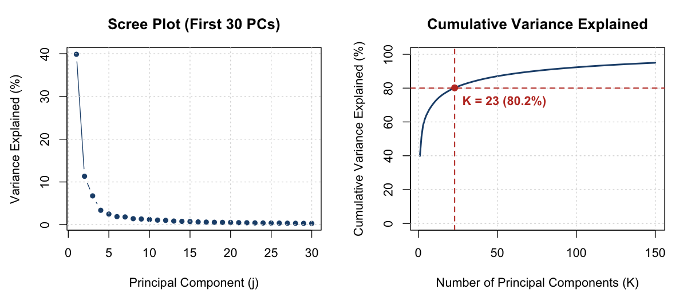
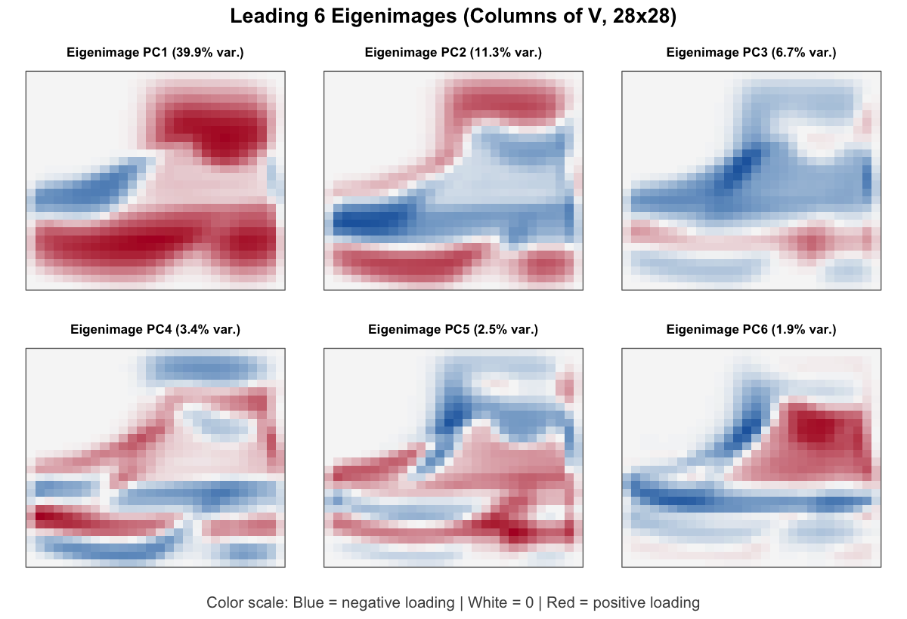

```{r setup, include=FALSE}
knitr::opts_chunk$set(
  echo = TRUE,
  warning = FALSE,
  message = FALSE,
  fig.align = "center",
  out.width = "85%"
)
set.seed(107258)
```

# Abstract

*Summary of research questions, PCA/SVD dimensionality reduction, outlier diagnostics, classification performance, and numerical insights (target report length: 8--12 pages).*

# Introduction

*Motivation, problem statement (Sneaker Class 7 vs. Ankle boot Class 9), and hypotheses.*

# Data and Reproducibility

*Dataset description, license, data dictionary, normalization to $[0, 1]$, and strict train/test separation (`fashion-mnist_test.csv` locked until final evaluation).*

# Methods

## Exploratory Data Analysis (EDA)

*Mean/variance images, multivariate PC1 vs. PC2 score plots with confidence ellipses, and cumulative variance uncertainty.*

## Dimensionality Reduction via Thin-SVD

Each $28 \times 28$ grayscale footwear image is flattened into a $p = 784$ pixel feature vector normalized to $[0, 1]$, yielding a balanced training matrix $X \in \mathbb{R}^{12\,000 \times 784}$ (6,000 Sneakers, Class 7; 6,000 Ankle boots, Class 9). Prior to decomposition, $X$ is centered column-wise strictly on the training observations by subtracting the empirical mean image $\bar{x}_{\text{train}} \in \mathbb{R}^{784}$:
$$X_c = X - \mathbf{1}\bar{x}_{\text{train}}^\top.$$
Unit-variance scaling (`scale = TRUE`) is deliberately avoided for two reasons: first, all 784 pixel features already share the identical $[0, 1]$ intensity scale; second, outer border pixels are almost always background (`0`), with $1$ pixel exhibiting exact zero variance ($\text{sd} = 0$) and $95$ pixels exhibiting near-zero variance ($\text{sd} < 0.01$), which would cause division-by-zero errors or artificially amplify border noise. After centering, the maximum absolute residual column mean is $7.02 \times 10^{-14}$ (machine-precision zero).

Principal Component Analysis (PCA) is computed via the **Thin Singular Value Decomposition (Thin-SVD)** directly on $X_c$ (`R/03_pca_svd.R`):
$$X_c = U \Sigma V^\top,$$
where $U \in \mathbb{R}^{12\,000 \times 784}$ has orthonormal columns, $\Sigma = \mathrm{diag}(d_1, \dots, d_{784})$ contains the non-negative singular values in descending order, and $V \in \mathbb{R}^{784 \times 784}$ contains the principal loading vectors (right singular vectors). The proportion of total variance explained by component $j$ is $d_j^2 / \sum_{i=1}^{784} d_i^2$, and the compressed principal component scores are obtained without redundant matrix multiplication as $Z = U \Sigma = X_c V$. To prevent data leakage, $\bar{x}_{\text{train}}$ and the leading columns of $V$ are saved in `output/models/pca_svd.rds` so that held-out observations are projected strictly via $Z_{\text{new}} = (X_{\text{new}} - \mathbf{1}\bar{x}_{\text{train}}^\top) V_K$.

```{r fig-scree, echo=FALSE, fig.cap="Scree plot of the first 30 principal components (left) and cumulative variance explained up to 150 components (right), highlighting the 80\\% threshold at $K = 23$ (80.15\\% variance explained)."}

```

As shown in the scree and cumulative variance plot above, the scree plot exhibits a sharp elbow: the first six components alone account for $65.7\%$ of total variance ($\text{PC1} = 39.9\%$, $\text{PC2} = 11.3\%$, $\text{PC3} = 6.7\%$, $\text{PC4} = 3.4\%$, $\text{PC5} = 2.5\%$, $\text{PC6} = 1.9\%$). Retaining **$K = 23$** components captures **$80.15\%$** of total pixel variance while reducing dimensionality by **$97.1\%$** (from $784$ down to $23$ orthogonal predictors). Reaching $90\%$ or $95\%$ variance would require $K = 73$ or $K = 151$ components, respectively, adding mostly high-frequency pixel noise. Moreover, $K = 23$ comfortably satisfies the sample-size requirement $n = 12\,000 \gg 2K = 46$ for downstream robust covariance estimation (`CovMcd`).

Reshaping the leading columns of $V$ back into upright $28 \times 28$ matrices yields interpretable **eigenimages** (shown below), visualized on a symmetric diverging scale (blue = negative loading, white = zero, red = positive loading):

```{r fig-eigenimages, echo=FALSE, fig.cap="Leading six eigenimages (columns of $V$ reshaped to upright $28 \\times 28$ grids). Blue denotes negative pixel loadings, white zero, and red positive loadings."}

```

- **PC1 ($39.9\%$ var.) — Primary class separator (ankle cuff & sole vs. flat vamp):** Strong positive loadings (red) concentrate along the high ankle shaft and thick sole/heel, whereas negative loadings (blue) highlight the low sneaker forefoot. Consistent with this morphology, class-wise mean PC1 scores separate sharply: Sneakers average $-3.60$ versus $+3.60$ for Ankle boots ($\Delta = +7.21$).
- **PC2 ($11.3\%$ var.) — Vertical framing and silhouette height:** Contrasts the upper shaft rim and bottom sole edge (red) against the central shoe body (blue), capturing within-class variation in overall height and vertical centering.
- **PC3 ($6.7\%$ var.) — Upper-body intensity vs. sole contrast:** Captures overall darkness/fill of the shoe body (blue) relative to a distinct lower sole stripe (red).
- **PC4–PC6 ($3.4\%$, $2.5\%$, $1.9\%$ var.) — Fine structural details:** Encode toe-box and sole curvature (PC4), the instep-to-ankle transition angle (PC5), and heel-counter / inner-ankle depth (PC6).

## Outlier Detection and Sensitivity Analysis

*Multivariate score-space screening via `CovMcd` ($\chi^2_{K, 0.975}$), ROBPCA (`PcaHubert`), GLM influence diagnostics (deviance residuals, hat values, Cook's distance), and coefficient/prediction comparison (`glm` vs. filtered vs. `glmrob`).*

## Downstream Classification and Cross-Validation

*Comparison of `glm`, `glmnet`, `glmrob`, and raw-pixel baseline under 5-fold cross-validation (ROC-AUC, PR-AUC, calibration).*

# Results and Diagnostics

*Tables (`knitr::kable` / `texreg`), figures, and final locked test-set evaluation.*

# Numerical Linear Algebra and Optimization Commentary

## Numerical Linear Algebra

A naive implementation of PCA explicitly forms the $784 \times 784$ sample covariance (or Gram) matrix $S = \frac{1}{n - 1} X_c^\top X_c$ and computes its eigendecomposition via `eigen(crossprod(X_c))`. In high-dimensional image data, however, forming $X_c^\top X_c$ explicitly is numerically hazardous for three interrelated reasons:

1. **Squaring of the condition number:** For any matrix $X_c$ with positive singular values $d_1 \ge \dots \ge d_r > 0$, the 2-norm condition number is $\kappa_2(X_c) = d_1 / d_r$. Forming the Gram matrix squares every singular value ($\lambda_j = d_j^2$), which squares the condition number:
   $$\kappa_2(X_c^\top X_c) = \frac{d_1^2}{d_r^2} = \kappa_2(X_c)^2.$$
2. **Rank deficiency from constant border pixels:** On our centered Fashion-MNIST footwear training matrix ($12\,000 \times 784$), $1$ border pixel has exact zero variance and $95$ pixels have $\text{sd} < 0.01$. Consequently, the effective numerical rank (singular values $> 10^{-10}$) is only **$755 / 784$**, meaning $29$ dimensions are numerically rank-deficient.
3. **Catastrophic cancellation in IEEE 754 floating-point arithmetic:** Standard double-precision floating-point arithmetic (IEEE 754 binary64) has machine epsilon $\varepsilon_{\text{mach}} \approx 2.22 \times 10^{-16}$, corresponding to roughly $15.7$ significant decimal digits. Across the $755$ positive singular values of our data, we observe:
   $$\kappa_2(X_c) = 6.45 \times 10^6 \quad \Longrightarrow \quad \kappa_2(X_c^\top X_c) = \kappa_2(X_c)^2 = 4.16 \times 10^{13}.$$
   While direct Thin-SVD on $X_c$ loses roughly $\log_{10}(6.45 \times 10^6) \approx 6.8$ digits—retaining approximately $9$ accurate digits—forming $X_c^\top X_c$ loses roughly $\log_{10}(4.16 \times 10^{13}) \approx 13.6$ digits. Small eigenvalues and their corresponding trailing eigenvectors are therefore severely corrupted by catastrophic cancellation when subtracting nearly equal products in $X_c^\top X_c$.

Using Base R's `svd(X_centered)` avoids forming $X_c^\top X_c$ entirely and computes the **Thin-SVD** ($U \in \mathbb{R}^{12\,000 \times 784}$ rather than the memory-prohibitive full $12\,000 \times 12\,000$ factor, which would exceed $1.1\text{ GB}$ in double precision). On our training set, the Thin-SVD completes in $\approx 10.6\text{ s}$; the systematic `microbenchmark` runtime comparison against `eigen(crossprod(X_c))` is integrated in the benchmarking subsection below.

## Optimization and Convergence

*IRLS / Newton-Raphson in `glm()`, local quadratic convergence, quasi-complete separation, and the Hauck-Donner effect motivating regularization in `glmnet`.*

# Ethics and Limitations

*Commercial catalog bias, $28 \times 28$ grayscale resolution loss, and lack of translation/rotation invariance.*

# Reproducibility and Session Information

```{r session-info}
sessionInfo()
```
